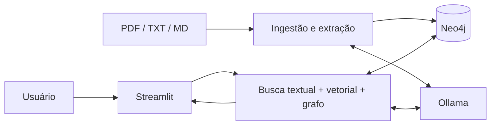
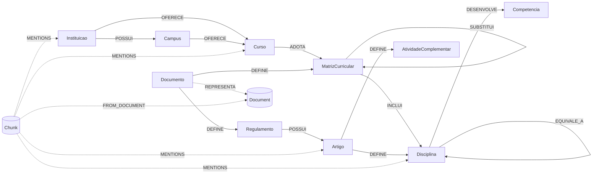

# GraphRAG/KAG — Educação Superior

Assistente acadêmico demonstrativo para consultar **cursos, matrizes curriculares, disciplinas, pré-requisitos e regulamentos**, combinando documentos e grafos de conhecimento. Implementa recuperação híbrida GraphRAG e exploração de relações como base para um protótipo KAG.

**Tecnologias:** Python · Streamlit · Neo4j · Ollama · Docker Compose.

> Dados sintéticos. Não substitui orientação da secretaria ou coordenação acadêmica.

## O que o projeto faz

- Importa PDF com texto selecionável, TXT e Markdown.
- Divide documentos em trechos (por parágrafo) e extrai entidades e relações com um modelo local, usando saída JSON estruturada.
- Aceita somente rótulos e relações previstos no domínio e exige um trecho literal como evidência das relações extraídas; a frase de evidência fica gravada na relação.
- Resolve entidades equivalentes (mesmo ID canônico, alias, sigla, similaridade de texto ou de embedding) para não duplicar nós.
- Combina busca vetorial (trechos e entidades) e textual (Lucene com radicalização do português), fundidas por Reciprocal Rank Fusion.
- Percorre o grafo em 1 a 3 saltos a partir das entidades da pergunta e monta cadeias dirigidas (ex.: pré-requisitos indiretos).
- Usa algoritmos de grafo do Neo4j GDS: PageRank ordena o contexto, Leiden agrupa comunidades e o caminho mínimo liga entidades da pergunta.
- Gera Cypher a partir da pergunta (Text2Cypher), com validação e execução somente leitura.
- Gera respostas que citam cada evidência ([T#] trechos, [P#] caminhos, [C#] linhas Cypher, [G#] comunidades), verifica as citações e calcula um nível de confiança; também permite consultar as evidências sem geração por IA.

## Arquitetura



O Compose coordena cinco serviços: `neo4j`, `ollama`, `models`, `seed` e `app`. O serviço `models` baixa os modelos; `seed` cria os índices e carrega os dados sintéticos. A aplicação inicia depois dessas etapas. O serviço adicional `tests` pertence ao perfil de testes.

## Início rápido com Docker

### Pré-requisitos

- Git e Docker com Compose; no Windows, Docker Desktop ativo com containers Linux e WSL 2.
- Internet na primeira execução para baixar imagens e modelos (vários GB).
- Memória e espaço disponíveis para Neo4j e os modelos locais. Os testes foram executados em um ambiente Docker com cerca de 15 GiB de memória disponível e execução de IA em CPU; isso não representa um requisito mínimo medido.

Não é necessário instalar Python, Neo4j ou Ollama separadamente para usar o Compose.

```bash
git clone https://github.com/RafaelFMAP/graphrag-educacao-superior.git
cd graphrag-educacao-superior
docker compose up --build -d
```

A primeira inicialização pode demorar. Acompanhe o download dos modelos e a carga dos dados:

```bash
docker compose logs -f models seed app
```

| Acesso | Endereço |
|---|---|
| Aplicação | http://localhost:8501 |
| Neo4j Browser | http://localhost:7474 |
| Neo4j Bolt | bolt://localhost:7687 |

Neo4j usa o usuário `neo4j` e a senha demonstrativa `graphrag_demo`, salvo configuração diferente. O Ollama fica acessível na rede interna do Compose. Os modelos padrão são `llama3.2:3b` e `nomic-embed-text`.

### Configuração opcional

O projeto funciona com os padrões do Compose. Para personalizar, copie `.env.example` para `.env`:

```powershell
# Windows PowerShell
Copy-Item .env.example .env
```

```bash
# Linux / macOS
cp .env.example .env
```

| Variável | Padrão / finalidade |
|---|---|
| `NEO4J_PASSWORD` | `graphrag_demo`; senha do banco |
| `OLLAMA_MODEL` | `llama3.2:3b`; geração e extração |
| `OLLAMA_EMBED_MODEL` | `nomic-embed-text`; requer 768 dimensões |
| `APP_PORT` | `8501`; porta local da interface |
| `NEO4J_HTTP_PORT` | `7474`; porta local do Neo4j Browser |
| `NEO4J_BOLT_PORT` | `7687`; porta local Bolt |

No Compose, `NEO4J_URI`, `NEO4J_USER` e `OLLAMA_URL` são definidos para a comunicação interna entre os containers. Os endereços locais de `.env.example` destinam-se à execução Python fora dos containers.

Para executar este projeto junto com o outro domínio, acrescente ao `.env` de um deles:

```dotenv
APP_PORT=8502
NEO4J_HTTP_PORT=7475
NEO4J_BOLT_PORT=7688
```

Cada domínio tem seu próprio nome de projeto Compose e volumes separados. Defina a senha antes da primeira carga: alterar `.env` não altera a senha já armazenada em um volume Neo4j existente.

## Como usar

1. Abra a aplicação e use a aba **Perguntas**. Escolha entre **GraphRAG híbrido** e **Somente vetorial (baseline)** para comparar as abordagens.
2. Leia a resposta e as citações ([T#], [P#], [C#], [G#]). Acima do grafo aparecem o **nível de confiança** (com os sinais que o compõem) e a contagem de citações válidas e inválidas.
3. Explore o **subgrafo interativo**: cor = comunidade (Leiden), tamanho = PageRank, estrela = entidade da pergunta, borda escura = entidade citada; passe o mouse sobre uma aresta para ver a frase de evidência.
4. Nas abas abaixo do grafo, consulte as **evidências numeradas**, os **nós consultados** (com PageRank e comunidade), as **consultas Cypher** executadas (Text2Cypher e consultas-modelo) e os **trechos** usados. Desmarque **Gerar resposta com Ollama** para ver só as evidências.
5. Na aba **Ingestão de documentos**, envie PDF, TXT ou MD e informe a versão. O resultado mostra as decisões de resolução de entidades e as relações recusadas pela assinatura de tipos; o PageRank e as comunidades são recalculados.
6. Na aba **Explorar caminhos**, escolha duas entidades pelo nome para ver o caminho mínimo entre elas, e consulte as entidades mais centrais.

Por exemplo: origem `Projeto Integrador` e destino `Algoritmos` mostram uma dependência indireta entre disciplinas.

### Perguntas de exemplo

- Quais são os pré-requisitos de Projeto Integrador?
- Quais disciplinas antecedem indiretamente Projeto Integrador?
- Qual matriz o curso adota?
- Quais disciplinas estão na Matriz 2026?
- Quais documentos fundamentam a matriz curricular?

Há 20 perguntas em `data/questions.json` para avaliação posterior e revisão humana.

## Testes

### Testes unitários no container

Independem do banco e dos modelos:

```bash
docker compose --profile test run --build --rm --no-deps tests
```

### Teste de integração

Após a inicialização completa:

```bash
docker compose exec -T app python smoke.py --llm
```

Verifica dados, índices, busca textual, caminhos e cadeias, PageRank/comunidades, a recusa de escrita na transação de leitura, procedência, interface Streamlit, embeddings, busca vetorial, Text2Cypher, citações e confiança com chamadas reais ao Ollama.

### Teste sem baixar modelos

Em uma instalação ainda sem os serviços iniciados, execute:

```bash
docker compose build
docker compose up -d --wait neo4j
docker compose run --rm --no-deps seed python seed.py --no-embeddings
docker compose up -d --no-deps --wait app
docker compose exec -T app python smoke.py
```

Esse modo valida busca textual e grafo. A geração e os embeddings exigem os modelos do Ollama; desative a geração na interface.

### Testes Python locais

Com Python e um ambiente virtual ativo:

```bash
python -m pip install -r requirements.txt
python -m pytest -q
```

**Resultado verificado em 15/11/2026:** 11/11 testes unitários no Windows e 11/11 no container Linux; construção Docker e teste completo de integração aprovados. Consulte [o relatório dos testes](TEST_RESULTS.md) para ambiente e limites da validação.

Para avaliar a qualidade da recuperação, revise `data/questions.json`, preencha `expected_sources` e marque `needs_manual_review` como `false` apenas nas perguntas validadas. Depois execute:

```bash
docker compose exec -T app python evaluate.py
```

Ainda não há métricas de qualidade: as perguntas e fontes esperadas aguardam revisão humana.

## Dados de demonstração

O corpus em `data/corpus/` é **sintético** e descreve a fictícia Universidade Exemplo:

| Documento | Conteúdo |
|---|---|
| `ppc-2026.md` | PPC 2026: Matriz 2026 com 40 disciplinas em 8 períodos, pré-requisitos, competências e ementas |
| `ppc-2022.md` | PPC 2022: Matriz 2022 (em extinção), pré-requisitos e tabela de equivalências com a Matriz 2026 |
| `regulamento-academico-2026.md` | Regulamento Acadêmico 2026: pré-requisitos, quebra de pré-requisito, aproveitamento, equivalência, atividades complementares e TCC |

`data/seed.json` é o **grafo-gabarito** (75 entidades, 167 relações). Cada relação registra a frase literal que a sustenta; o `seed.py` ingere o corpus e liga cada relação ao trecho (`Chunk`) que contém essa frase. Corpus e gabarito são gerados juntos por `python scripts/gerar_corpus.py`, o que garante que toda evidência exista no texto. O gabarito também serve para medir a qualidade da extração por LLM.

> Ao atualizar uma instalação anterior, recrie os volumes do banco para descartar os dados antigos: `docker compose down -v && docker compose up --build -d` (os modelos do Ollama precisarão ser baixados de novo), ou execute `docker compose run --rm seed python seed.py --reset`.

## Modelagem do grafo



- `Entity` (+ rótulo do domínio): `id`, `name`, `kind`, `aliases`, `embedding`.
- `Document`: título, versão e origem. `Chunk`: texto, localização e embedding; ligado ao documento por `FROM_DOCUMENT` e às entidades por `MENTIONS`.
- Relações de domínio registram `evidence` (frase literal), `evidence_id` (trecho de origem) e `source_type` (`synthetic_seed` ou `llm_verified_excerpt`).
- Linhas tracejadas são relações estruturais, fora da allowlist do domínio.
- **Restrições semânticas:** `domain.json` define, para cada relação, os rótulos permitidos na origem e no destino (`relation_signatures`). `GraphStore.put_edge` recusa relações que violem essa assinatura, como `Curso -ADOTA-> Documento`, mesmo que tenham evidência literal; a ingestão lista as recusas em `rejected`.

**Constraints e índices** (ver `schema.cypher`): unicidade de `id` em `Entity`, `Chunk` e `Document`; índices RANGE (substitutos do BTree no Neo4j 5) em `Entity.name`, `Entity.kind`, `Document.version` e `Chunk.locator`; fulltext em `Entity` (nome, id, aliases) e `Chunk.text`; vetoriais de 768 dimensões em `Chunk.embedding` e `Entity.embedding`.

**Rótulos permitidos:** `Instituicao`, `Campus`, `Curso`, `MatrizCurricular`, `Disciplina`, `Prerequisito`, `Ementa`, `Competencia`, `Regulamento`, `Artigo`, `PeriodoLetivo`, `AtividadeComplementar`, `Documento`.

**Relações permitidas:** `OFERECE`, `ADOTA`, `INCLUI`, `EXIGE`, `POSSUI`, `DESENVOLVE`, `DEFINE`, `SUBSTITUI`, `PERTENCE_A`, `EQUIVALE_A`.

### Resolução de entidades

`entity_resolution.py` decide, para cada entidade extraída, se ela já existe no grafo, sempre dentro do mesmo rótulo: (1) mesmo ID canônico; (2) alias registrado; (3) sigla com iniciais únicas (`POO`, `TCC I`); (4) similaridade de caracteres ≥ 90 (`Estrutura de Dados`); (5) similaridade de embedding no índice `entity_vector`. Duas proteções evitam fusões erradas: numerais diferentes (`Cálculo I` ≠ `Cálculo II`) e nomes em que um estende o outro (`Banco de Dados` ≠ `Banco de Dados Avançado`). O nome encontrado vira alias da entidade existente, e o resultado da ingestão lista cada decisão.

As consultas Cypher usam parâmetros e relações/rótulos validados por lista permitida. A presença de evidência literal é uma validação técnica; ainda é necessário revisar a interpretação semântica da relação.

## Recuperação híbrida e raciocínio multi-hop

`retrieval.answer()` executa, para cada pergunta:

1. **Ligação de entidades**: nomes e aliases citados na pergunta; na falta deles, busca vetorial (`entity_vector`) e fulltext (`entity_text`).
2. **Trechos**: busca vetorial (`chunk_vector`) e fulltext (`chunk_text`, analisador `brazilian`) fundidas por RRF, mais os trechos de procedência das relações recuperadas.
3. **Grafo**: as palavras da pergunta indicam as relações relevantes (ex.: "pré-requisito" → `EXIGE`). A expansão Cypher de 1 a 3 saltos não atravessa hubs (grau > 15) e é ordenada por distância e PageRank. Para relações dirigidas, o grafo monta **cadeias completas** (`Projeto Integrador → Banco de Dados → Estruturas de Dados → Algoritmos`), entregando ao LLM o raciocínio multi-hop já resolvido. Também entram os caminhos mínimos entre entidades da pergunta e a comunidade Leiden de cada uma.
4. **Text2Cypher** (`text2cypher.py`): o LLM recebe o esquema, exemplos e as entidades reconhecidas e gera uma consulta. A validação recusa escrita, `CALL`, múltiplas instruções, comentários e rótulos ou relações fora da allowlist, e impõe `LIMIT` ≤ 100. A consulta roda numa transação de **leitura** com timeout de 5 s, então o próprio Neo4j recusa qualquer escrita. Se falhar, o erro volta ao LLM numa segunda tentativa; persistindo a falha, a resposta usa só a busca híbrida.
5. **Geração fundamentada**: o LLM responde citando os identificadores das evidências. `confidence.py` confere cada citação contra o contexto, sinaliza citações inexistentes ou ausentes e calcula a confiança (Alta/Média/Baixa) com quatro sinais documentados: fundamentação das citações, força da busca vetorial, cobertura do grafo e resultado do Cypher. Uma abstenção ("não há evidência suficiente") é sempre classificada como Baixa.

**Algoritmos de grafo** (`analytics.py`, Neo4j Graph Data Science, instalado pelo Compose via `NEO4J_PLUGINS`): PageRank sobre o grafo dirigido (com `EQUIVALE_A` sem direção) e Leiden sobre o grafo não dirigido, gravados em `Entity.pagerank` e `Entity.community`. Rodam ao fim do `seed.py` e podem ser repetidos com `docker compose exec app python analytics.py`.

## Estrutura do repositório

```text
app.py                 Interface Streamlit
graph_view.py          Subgrafo interativo (pyvis / vis-network)
config.py              Configuração e domínio
domain.json            Rótulos, relações e aviso do domínio
pipeline.py            Leitura, divisão em trechos, extração e ingestão
graph_store.py         Neo4j, índices e consultas
entity_resolution.py   Resolução de entidades (canonicalização)
schema.cypher          Constraints e índices documentados
retrieval.py           Recuperação híbrida, cadeias multi-hop e geração
text2cypher.py         Geração, validação e execução segura de Cypher
confidence.py          Verificação de citações e nível de confiança
analytics.py           PageRank e Leiden (Neo4j GDS)
ollama_client.py       Chat e embeddings locais
seed.py                Carga dos dados sintéticos
smoke.py               Teste de integração
evaluate.py            Avaliação de perguntas revisadas
data/                  Corpus sintético, grafo-gabarito e perguntas
scripts/               Geração do corpus e do gabarito
tests/                 Testes unitários
Dockerfile             Imagem da aplicação
docker-compose.yml     Orquestração dos serviços
.env.example           Exemplo de configuração
TEST_RESULTS.md        Resultados e limites dos testes
```

## Operação e solução de problemas

```bash
# Estado dos serviços
docker compose ps -a
# Últimas mensagens
docker compose logs --tail 100 app neo4j ollama models seed
# Parar e preservar os dados e modelos
docker compose down
# Iniciar novamente
docker compose up -d
```

- **Interface ainda indisponível:** confira `models` e `seed`; a aplicação aguarda o término dessas etapas.
- **Porta ocupada:** altere as portas locais no `.env` e execute `docker compose up -d` novamente.
- **Falha de senha Neo4j:** confira a senha usada quando o volume foi criado.
- **Geração lenta ou timeout:** os modelos usam CPU nesta configuração; confira os logs do Ollama e os recursos disponíveis.
- **PDF sem conteúdo:** o projeto não faz OCR; use um PDF com texto selecionável ou extraia o texto previamente.
- **Mudança do modelo de embeddings:** o índice e o cliente esperam 768 dimensões; outro formato exige adaptação do código e do índice.

## Limitações

Protótipo acadêmico com dados sintéticos. Não oferece autenticação da aplicação, isolamento multiusuário, OCR nem auditoria persistente. Entidades com o mesmo nome podem precisar de identificadores específicos por obra, curso ou versão. Relações extraídas e respostas geradas exigem revisão humana.

A estratégia combina documentos, recuperação híbrida e caminhos no grafo; não implementa um framework KAG completo com regras formais de inferência. As dependências usam faixas de versões e a imagem Ollama usa `latest`, portanto instalações futuras podem resolver versões diferentes. Para reprodução estrita, fixe versões e digests.

O arquivo `.env` é ignorado pelo Git. Preserve a confidencialidade dos documentos importados e obtenha autorização para utilizá-los.
